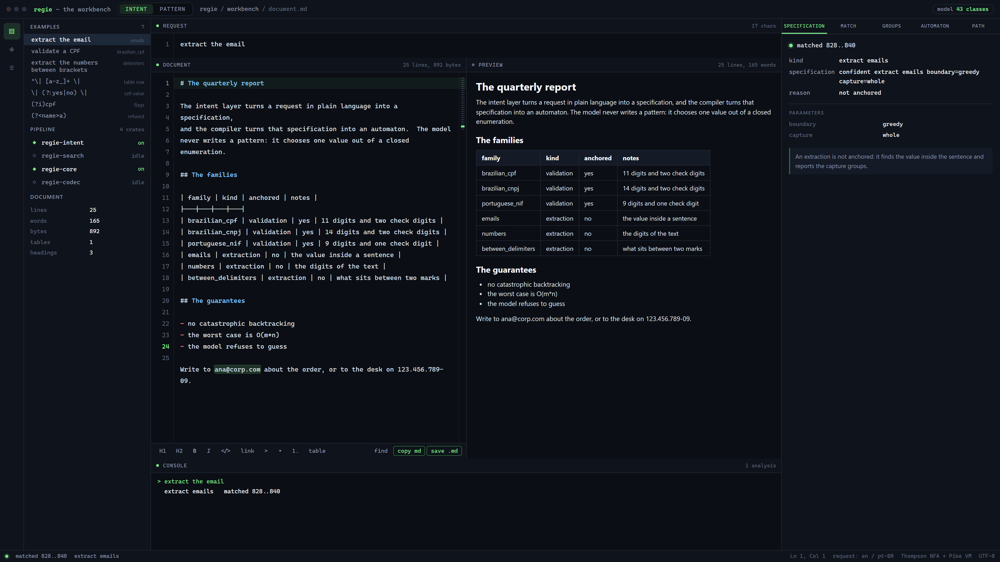
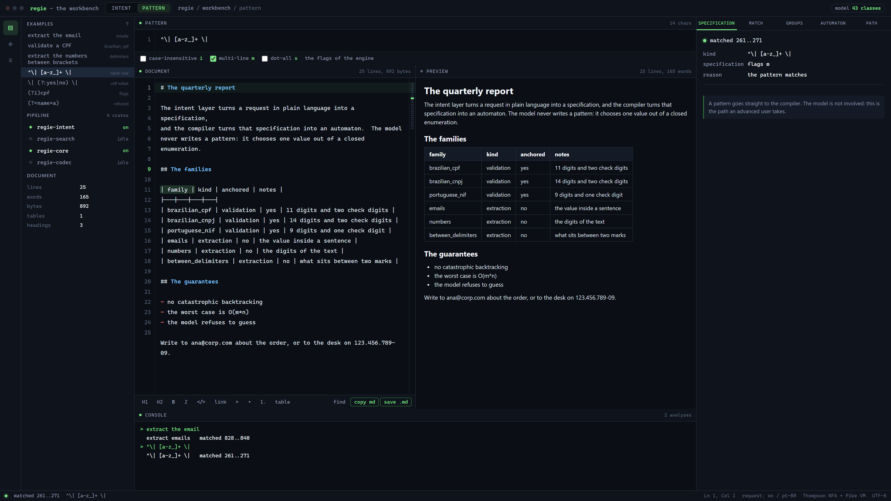
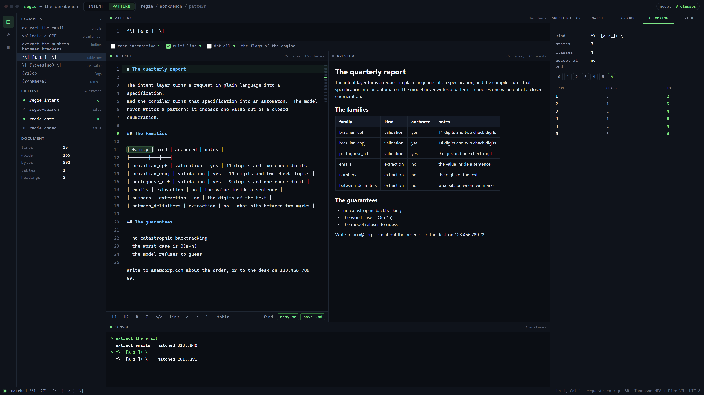
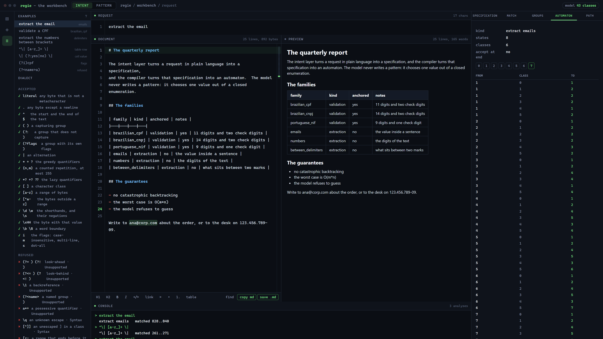

# regie

**A regex engine that never backtracks, never allocates, and never guesses.**

`regie` is a Rust workspace for embedded targets. It answers "does this text
match?" with a predictable worst case, a fixed memory footprint, and no
allocator. On top of that it adds an *intent* layer: a tiny local model that
turns "check whether this is a valid CPF" into a structured specification,
which a verified search then narrows down against examples you provide.

The point of the intent layer is what it **refuses** to do. It never emits
pattern text. It chooses from a closed enumeration of validation families,
extraction families, filters and templates, and the deterministic compiler
turns that choice into an automaton. A model cannot smuggle arbitrary syntax
into the engine, because it has no way to express any.

```text
"validate a brazilian cpf"
        │
        ▼
   regie-intent ──► IntentSpec::Confident(Validate { kind: BrazilianCpf, … })
        │            or IntentSpec::Ambiguous { reason, suggestions }
        ▼
   regie-search ──► the specification that matches every positive example
        │            and rejects every negative one, or Ambiguous
        ▼
   regie-core  ──► Thompson NFA + Pike VM, or a compact DFA
        │
        ▼
   regie-codec ──► an `RGDF` blob linked into the firmware
```

## Try it in one minute

Two commands, from the repository root. The first matches a pattern; the
second turns a sentence into a specification.

```console
$ cargo run -p regie-cli --bin regie -- match '(\w+)@(\w+\.\w+)' 'mail: ana@corp.com'
match: 6..18 "ana@corp.com"
group 1: 6..9 "ana"
group 2: 10..18 "corp.com"

$ cargo run -p regie-cli --bin regie -- intent 'validate a CPF'
summary: confident validate brazilian_cpf strictness=standard charset=digits max_len=14
{"candidate":{"charset":"digits","kind":"brazilian_cpf","max_len":14,"strictness":"standard","type":"validate"},"status":"confident"}
```

Every example in the project is collected in
[docs/EXAMPLES.md](docs/EXAMPLES.md), which starts with the whole picture and
then links to a gallery per crate:

| gallery | what it covers |
|---|---|
| [regie-core](crates/regie-core/EXAMPLES.md) | the dialect, capture groups, specifications, refusals, limits, the DFA, the error type, the hard patterns, the linear time guarantee |
| [regie-intent](crates/regie-intent/EXAMPLES.md) | interpreting a request, the ambiguity path, the model profile, the hard requests |
| [regie-search](crates/regie-search/EXAMPLES.md) | searching with examples, discriminating between candidates, refusing to settle, the hard discrimination |
| [regie-codec](crates/regie-codec/EXAMPLES.md) | the artifact layout, the round trip, a corrupted artifact, the hard artifacts |
| [regie-cli](crates/regie-cli/EXAMPLES.md) | every subcommand, and scripting with the exit codes |

Every runnable example in the project has its output checked by
`tools/check_examples.py`, so the quotes in the galleries are the output of
the code, not a transcription of it.

## The crates

| crate | what it does | depends on |
|---|---|---|
| [`regie-core`](crates/regie-core) | the engine: parser, compiler, Pike VM, DFA builder | nothing |
| [`regie-intent`](crates/regie-intent) | the micro-model: request → specification | `regie-core` |
| [`regie-search`](crates/regie-search) | verified hypothesis search: specification + examples → specification | `regie-intent`, `regie-core` |
| [`regie-codec`](crates/regie-codec) | the `RGDF` artifact format: automaton ⇄ bytes | `regie-core` |
| [`regie-cli`](crates/regie-cli) | the `regie` command line tool | all of the above |

The dependency graph is a straight line. `regie-core` knows nothing about
intents, models or files; `regie-intent` knows nothing about matching.

## The languages of a request

The intent layer understands a request written in **English** or in
**Brazilian Portuguese**, and in no other language. The same request in either
of the two reaches the same family; a request in a language that is not
supported comes back as an ambiguity, which is the honest answer.

The list is in [docs/LANGUAGES.md](docs/LANGUAGES.md) and it is checked by a
test, so it cannot drift away from the model.

## Why five crates

They split along the lines of what changes for different reasons. The dialect
and the engine change in `regie-core`, the model and its corpus in
`regie-intent`, the search strategy in `regie-search`, the artifact format in
`regie-codec`, and the command line in `regie-cli`. A firmware build that only
needs a matcher links exactly one crate and nothing else.

## When not to use it

* If you need look-around, backreferences or recursion, use a full engine.
  This one refuses them on purpose, because they are exactly what makes
  matching unpredictable.
* If you need Unicode-aware classes and you have memory to spare, the `regex`
  crate is faster and more complete. [docs/PERFORMANCE.md](docs/PERFORMANCE.md)
  has the measured gap.
* If you want a model that writes patterns, this is the wrong project on
  purpose. The intent layer produces specifications, never pattern text.

## Quick start

```toml
[dependencies]
regie-core = "0.1"
```

```rust
use regie_core::Regex;

let re = Regex::new(r"^\d{3}-\d{4}$").expect("the pattern compiles");

assert!(re.is_match(b"555-1234"));
assert!(!re.is_match(b"5551234"));

let re = Regex::new(r"(\w+)@(\w+)").expect("the pattern compiles");
let caps = re.captures(b"mail: ana@corp").expect("the pattern matches");
assert_eq!(caps.get(1).expect("group 1 took part").start, 6);
```

The intent layer, on a host with an allocator:

```rust
use regie_core::spec::IntentSpec;
use regie_intent::IntentModel;

let model = IntentModel::embedded();

match model.interpret("validate a CPF") {
    IntentSpec::Confident(spec) => {
        let re = regie_core::Regex::from_spec(&spec).expect("the specification compiles");
        assert!(re.is_match(b"123.456.789-09"));
    }
    IntentSpec::Ambiguous { reason, .. } => {
        // The model refused to guess.  This is a normal outcome.
        println!("ambiguous: {reason:?}");
    }
}
```

And the verified search, which narrows a request down with examples:

```rust
use regie_search::{search, Examples};

let positives = ["123.456.789-09"];
let negatives = ["123.456.789"];
let report = search("validate a CPF", Examples::new(&positives, &negatives));

assert!(report.is_confident());
```

## The guarantees

These are the properties the project is built around. Each of them is
enforced by a test.

* **No catastrophic backtracking.** The engine simulates an NFA; it never
  backtracks. A pattern of `m` instructions over an input of `n` bytes takes
  `O(m · n)` time, always. There is no input that makes it worse.
* **No allocator on the default path.** `regie-core` is `#![no_std]` and
  allocation-free unless the `alloc` feature is on. A compiled pattern lives
  entirely in a fixed-size value.
* **No panics on user input.** Every failure is a variant of `RegexError`.
  A malformed pattern, an oversized pattern, a pattern that exceeds a budget:
  all of them are values, not panics.
* **No `unsafe`.** Every crate in the workspace is `#![forbid(unsafe_code)]`.
* **Determinism.** The same input gives the same output on every platform:
  there is no floating point, no hashing and no randomness in the matching
  path. The intent model is integer-only end to end.
* **A bounded model.** The intent model is 1,419 lexical features over 43
  classes, stored as `i8` weights. The whole model is 97 KiB, against a
  budget of 256 KiB.

## The dialect

The pattern dialect is small on purpose. It supports literals, character
classes and ranges, the shorthands `\d \D \w \W \s \S`, the anchors `^ $` and
`\b \B`, groups (capturing and not), alternation, the quantifiers
`* + ? {n} {n,} {n,m}` with greedy and lazy variants, the flags `i m s`, and
the escapes `\n \r \t \f \v \a \e \b \0 \xHH`.

It **refuses** look-around, backreferences, recursion, named groups,
possessive quantifiers and unknown escapes, each with an explicit error
rather than a reinterpretation. [docs/SYNTAX.md](docs/SYNTAX.md) has the
full grammar and the complete list of refusals.

The dialect is checked against Python's `re` with a differential test that
compares the two engines on **24,589** cases, including the cases where
neither matches and the cases where both refuse the pattern. The current
result is zero mismatches.

## The firmware path

The target does not compile anything. A pattern is compiled on a
workstation, serialized into a compact blob, and linked into the image:

```rust
use regie_codec::decode;

// A `static` blob, produced by `regie dfa <pattern> <file>`.
static ARTIFACT: &[u8] = include_bytes!("pattern.rdf");

let dfa = decode(ARTIFACT).expect("the artifact is well formed");
assert!(dfa.is_match(b"ana@corp.com"));
```

The artifact format is `RGDF` v1: a 16-byte header, the byte-class table,
the accept bitmap, the transition table and a CRC-32, all little-endian
whatever the host is. The decoder rejects anything malformed without
panicking. See [crates/regie-codec](crates/regie-codec) for the byte layout.

## The command line

```console
$ regie match '(\w+)@(\w+\.\w+)' 'mail: ana@corp.com'
match: 6..18 "ana@corp.com"
group 1: 6..9 "ana"
group 2: 10..18 "corp.com"

$ regie intent 'validate a CPF'
summary: confident validate brazilian_cpf strictness=standard charset=digits max_len=14
{"candidate":{"charset":"digits","kind":"brazilian_cpf","max_len":14,"strictness":"standard","type":"validate"},"status":"confident"}

$ regie search 'validate a CPF' --positive '123.456.789-09' --negative '123.456.789'
search: confident
candidate: validate brazilian_cpf strictness=standard charset=digits max_len=14
rank 1: validate brazilian_cpf score=1100 positives=1/1 negatives_rejected=1/1
rank 2: validate brazilian_cpf score=1100 positives=1/1 negatives_rejected=1/1
rank 3: validate brazilian_cpf score=1100 positives=1/1 negatives_rejected=1/1
rank 4: validate brazilian_cpf score=1100 positives=1/1 negatives_rejected=1/1
explored: 64 candidates, 52 rejected

$ regie dfa '^ana@corp\.com$' ana.rdf
wrote 558 bytes to ana.rdf (14 states, 10 byte classes)
```

## The workbench

`regie serve` puts the same engine in a browser. The page is embedded in the
binary, the server listens on the loopback interface only, and nothing leaves
the machine:

```text
$ cargo run -p regie-cli --bin regie -- serve --port 8080
regie is serving the live view on http://127.0.0.1:8080
press ctrl-c to stop it
```



*In the intent mode a request in plain language goes through the model and
comes back as a specification. The document on the left is a Markdown file
with a live preview, and the match is lit up in it.*

The mode switch at the top sends the pattern straight to the compiler, which is
the path an advanced user takes. The flags of the engine are there, the match
is shown in the document, and the automaton tab shows what the pattern costs:





The document is a Markdown editor: the toolbar writes the markup, the find bar
replaces, and the document is saved as a `.md` file or copied to the
clipboard.

The dialect panel lists what the engine accepts and what it refuses, with the
reason of every refusal:



## The live view

`regie show` builds the needle for you and shows what it caught. The request
goes through the intent layer, the specification goes through the compiler, and
the engine runs the automaton over the haystack:

```console
$ cargo run -p regie-cli --bin regie -- show 'extract the email' --input 'mail ana@corp.com now'
request: extract the email
intent: confident extract emails boundary=greedy capture=whole
haystack: mail ana@corp.com now
     ^^^^^^^^^^^^ matched 5..17
groups:
  0: 5..17 "ana@corp.com"
  1: 5..17 "ana@corp.com"
```

## Building

```console
cargo build --workspace            # everything, with the defaults
cargo test  --workspace --all-features
cargo build -p regie-core --no-default-features --target thumbv7em-none-eabihf
cargo bench -p regie-core
```

The workspace builds for `x86_64-unknown-linux-gnu`, `aarch64-unknown-none`,
`thumbv7em-none-eabihf` and `riscv32imac-unknown-none-elf`; the CI matrix
covers all of them plus the host platforms.

### Features

| crate | feature | effect |
|---|---|---|
| `regie-core` | *(none)* | `no_std`, no allocator: parser, compiler, Pike VM |
| | `alloc` | the DFA builder |
| | `std` | `std::error::Error` for `RegexError` |
| | `serde` | `Serialize`/`Deserialize` for the specification types |
| | `unicode` | UTF-8 aware character classes |
| `regie-codec` | `alloc` | `encode_to_vec` |
| `regie-intent` | `alloc`, `std`, `serde` | as above |
| `regie-search` | `alloc`, `std`, `mcts` | `mcts` enables the bounded tree search |

## Documentation

* [docs/EXAMPLES.md](docs/EXAMPLES.md) — the way in: the whole project on one
  page, then a gallery per crate.
* [docs/ARCHITECTURE.md](docs/ARCHITECTURE.md) — how the engine works, and
  why it is built this way.
* [docs/SYNTAX.md](docs/SYNTAX.md) — the complete dialect, with a catalogue of
  what it accepts and what it refuses.
* [docs/LANGUAGES.md](docs/LANGUAGES.md) — the languages a request can be
  written in, and what happens to one that is not.
* [docs/PERFORMANCE.md](docs/PERFORMANCE.md) — the measured numbers, and the
  comparison with `regex-automata`.
* [docs/EVOLUTION.md](docs/EVOLUTION.md) — what comes next, and what is
  deliberately not planned.
* [crates/regie-core/README.md](crates/regie-core/README.md) and the
  per-crate READMEs.

## Testing

| suite | what it covers |
|---|---|
| `cargo test --workspace` | 213 unit, integration and documentation tests |
| `tools/differential_test.py` | 24,589 cases against Python's `re` |
| `tools/check_examples.py` | every output quoted in the documentation |
| `tools/measure_languages.py` | the phrasings of the corpus per family and per language |
| `cargo llvm-cov` | line coverage of `regie-core`, above 90% |
| `fuzz/` | two fuzz targets: the parser and the compiler |
| `cargo bench` | the Criterion suite of `regie-core` |

## Licence

Licensed under either of Apache License, Version 2.0 or MIT license at your
option.

[Apache-2.0]: https://www.apache.org/licenses/LICENSE-2.0
[MIT]: https://opensource.org/licenses/MIT
